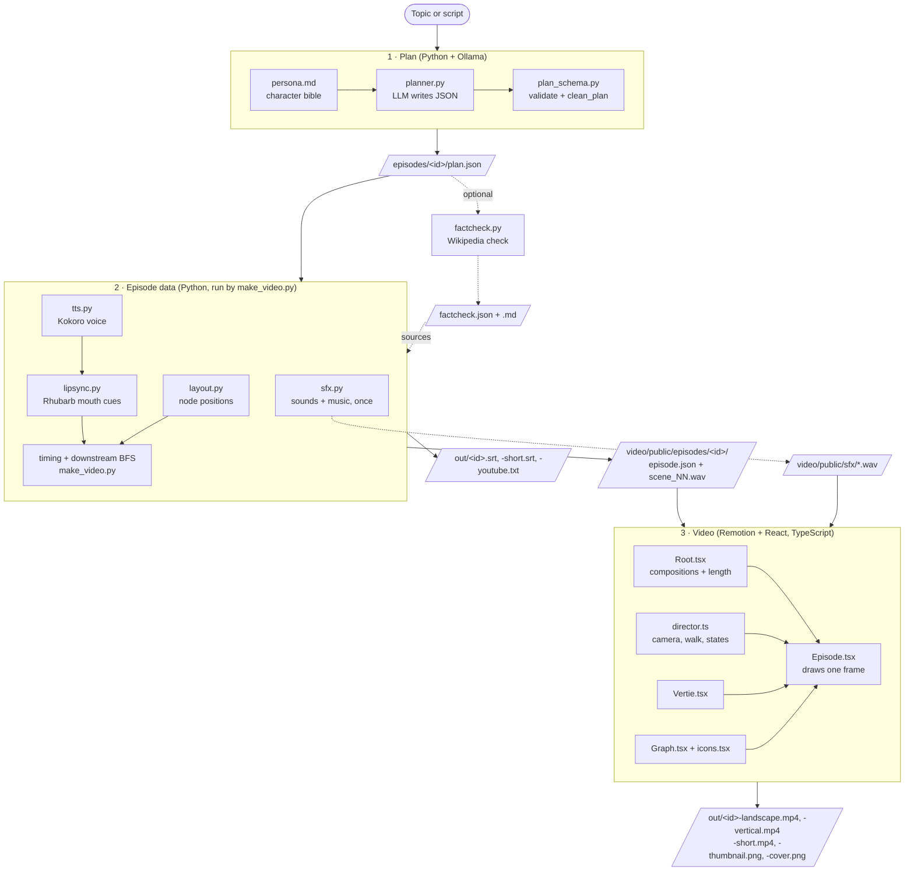
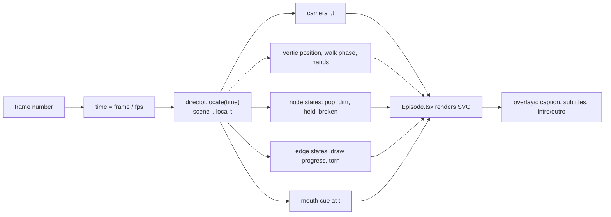

# Architecture

Graph Explorer turns a topic (or a script) into a narrated, animated explainer video
hosted by **Vertie**, in two formats: 16:9 (1920 × 1080) and 9:16 (1080 × 1920).
Everything runs locally on a Mac.

The system has three stages. Each one reads a plain file and writes the next, so
you can stop after any stage, inspect or edit the file, and carry on.



## Repository layout

```
graph-explorer/
├── pipeline/                 Python: everything that prepares data
│   ├── make_video.py         entry point; runs stages 1–3
│   ├── persona.md            Vertie's character bible (prompt)
│   ├── planner.py            Ollama call with JSON-schema output
│   ├── plan_schema.py        Pydantic models, ICONS list, clean_plan()
│   ├── episode_types.py      TypedDicts for episode.json (mirrors video/src/types.ts)
│   ├── layout.py             networkx layout of each graph
│   ├── tts.py                Kokoro (default) / espeak narration
│   ├── lipsync.py            Rhubarb wrapper
│   ├── simulate.py           feedback-loop simulation (extension)
│   ├── publish.py            SRT captions, YouTube text, Shorts segments
│   ├── factcheck.py          narration claims checked against Wikipedia
│   └── sfx.py                synthesised sound effects + music bed
├── episodes/<id>/plan.json   scene plans (stage 1 output, hand-editable)
├── video/                    TypeScript: everything that draws
│   ├── src/index.ts          registers Root
│   ├── src/Root.tsx          Landscape, Vertical, Short + Thumbnail, Cover stills
│   ├── src/Thumbnail.tsx     thumbnail and cover stills
│   ├── src/Backdrop.tsx      parallax background layers + light beams
│   ├── src/director.ts       per-frame state: camera, Vertie, nodes, edges, sfx
│   ├── src/Episode.tsx       renders a frame + places audio
│   ├── src/SimPanel.tsx      live simulation plot (extension)
│   ├── src/character/Vertie.tsx
│   ├── src/graph/Graph.tsx
│   ├── src/graph/icons.tsx
│   ├── src/theme.ts          palette, fonts, colour mixing
│   ├── src/types.ts          TypeScript shape of episode.json
│   └── public/               files Remotion can load (episodes/, sfx/)
├── art/                      character sheet generator + SVG
├── tools/                    Rhubarb binary (third-party, not committed)
├── docs/                     this documentation
└── out/                      rendered videos
```

## Stage 1: plan

**Goal:** turn free text into a strictly shaped scene list. The LLM is treated as
an unreliable upstream source: its output shape is constrained, then validated,
then repaired.

| Component | Responsibility |
| --- | --- |
| `persona.md` | Who Vertie is, how it talks, signature lines, banned words, episode shape (hook → build → pull → restore → zoom out). Sent verbatim as the start of the system prompt. |
| `planner.py` | Builds the prompt (`persona.md` + `RULES` + the topic or script) and calls Ollama `/api/chat` with `format` set to the plan's JSON Schema, so generation is constrained to valid JSON of that shape. |
| `plan_schema.py` | `Plan → PlanScene → PlanNode / PlanEdge` Pydantic models. `Literal` types limit expressions, poses, colours and the 33 icon names to things the renderer can draw. |
| `clean_plan()` | Semantic repair, walking scenes in order: normalises ids, removes duplicates, caps 3 new nodes per scene and 9 per graph, drops dangling edges/focus/reach, allows one removed node at a time, cancels orphan restores, forces the pull scene into the `reach` pose. Keeps a stack of boards for `open`/`close` (zoom) and renames ids reused on another board. `boards()` then tells every later step which board each scene is on. |
| `factcheck.py` | Optional: claims → Wikipedia passages → verdict with a verified quote. Writes `factcheck.json` + `factcheck.md`; see [FACTCHECK.md](FACTCHECK.md). |

### `plan.json` contract

```jsonc
{
  "title": "Why does it rain?",
  "scenes": [
    {
      "narration": "Warm water evaporates. It drifts up into the sky.",
      "caption": "Evaporation",            // optional on-screen heading
      "expression": "curious",             // neutral | curious | excited | puzzled
      "pose": "reach",                     // idle | wave | point | think | reach | cheer
      "reach": "vapour",                   // node Vertie touches (with pose "reach")
      "new_graph": false,                  // true = clear the board
      "open": null, "close": false,        // dive into a node / come back out (ZOOM.md)
      "add_nodes": [{ "id": "vapour", "label": "Vapour", "color": "chalk", "icon": "vapour" }],
      "add_edges": [{ "from": "sea", "to": "vapour", "label": "evaporates" }],
      "focus": ["sea", "vapour"],          // highlighted nodes
      "remove": null,                      // node pulled out ("what if" beat)
      "restore": false                     // put the pulled node back
    }
  ]
}
```

Edge direction means **cause → effect**. That direction matters in stage 2.

## Stage 2: episode data

`build_episode()` in `make_video.py` turns the plan into everything the renderer
needs, so the TypeScript side never deals with language, audio analysis or graph
algorithms.

| Step | Component | What it produces |
| --- | --- | --- |
| Layout | `layout.py` | One position per node, computed on the **final** graph of each group (board, from `boards()`) so nodes never move as the graph grows. Kamada–Kawai for connected graphs (screen distance ≈ hop distance), seeded spring layout otherwise. Normalised to 0–1 with a 10% margin. |
| Voice | `tts.py` | `scene_NN.wav` per scene. Kokoro `KPipeline(lang_code="b")` (British English), cached in a module variable; 24 kHz output. `--engine espeak` is a no-download fallback. |
| Lip-sync | `lipsync.py` | Rhubarb mouth cues `{start, end, value}` with values A–H (mouth shapes) or X (rest). The narration is passed as `--dialogFile` to help recognition. |
| Timing | `make_video.py` | `duration = max(0.35 + speech + 0.7, animation_time + 0.6)`. The 0.35 s lead is stored as `audioOffset`, and mouth cues are shifted by it. |
| Pull beat | `downstream()` | Breadth-first search along edge direction from the removed node; returns `{node: depth}` so breakage ripples outwards. Also tracks `heldAtStart` / `heldAtEnd`. |
| Simulation | `simulate.py` | Only when a scene has `nudge`: per-frame values for every node of that graph, see [FEEDBACK_LOOPS.md](FEEDBACK_LOOPS.md). |
| Publishing | `publish.py` | Shorts segments (stored in `episode.json`), SRTs, YouTube description; see [PUBLISHING.md](PUBLISHING.md). |
| Sound | `sfx.py` | `pop`, `whoosh`, `snap`, `wobble`, `chime`, `steps`, `stamp`, `dial`, `music` WAVs, synthesised with numpy. Missing files are generated on every run; existing ones are left alone (`--force` regenerates). |

### `episode.json` contract

Defined twice, once per language, and the two must match: `pipeline/episode_types.py`
(TypedDicts, so the editor checks every key on the Python side) and
`video/src/types.ts` (interfaces for the renderer). Key fields:

| Field | Meaning |
| --- | --- |
| `fps`, `intro`, `outro` | 30 fps; intro 3.2 s; outro 3.8 s |
| `nodes[]` | `id, label, color, icon, x, y` (0–1), `scene` (first appears), `group` (graph board) |
| `edges[]` | `from, to, label, scene, group` |
| `scenes[]` | everything from the plan, plus `audio`, `audioOffset`, `duration`, `mouthCues`, `heldAtStart`, `heldAtEnd`, `broken` (`{id: depth}`) |
| `music` | optional per-episode music file; falls back to `sfx/music.wav` |
| `scenes[].zoom`, `.path`, `.animOffset` | zooming into a node, see [ZOOM.md](ZOOM.md) |
| `sources` | `[{title, url}]` of fact-checked claims, shown on the outro, see [FACTCHECK.md](FACTCHECK.md) |
| `short` | Shorts cut: `[{start, end, scene}]` in episode seconds, see [PUBLISHING.md](PUBLISHING.md) |
| `edges[].sign`, `scenes[].loop`, `scenes[].nudge`, `sim` | feedback-loop extension, see [FEEDBACK_LOOPS.md](FEEDBACK_LOOPS.md) |

## Stage 3: video

### Rendering model

Remotion renders React in headless Chrome one frame at a time, screenshots each
frame and muxes the result with ffmpeg. **Every frame is a pure function of the
frame number.** There is no state carried between frames and no randomness, so
frames can render in parallel and Studio can scrub to any point. Pseudo-random
decoration (the dust) uses a deterministic sine hash.



### Components

| Component | Responsibility |
| --- | --- |
| `Root.tsx` | Registers `Landscape`, `Vertical` and `Short` at 30 fps, plus the `Thumbnail` and `Cover` stills. `calculateMetadata` loads `episode.json` and sets the duration (intro + scenes + outro). |
| `director.ts` | Built once per episode. Precomputes per scene **where Vertie stands** (scores about ten candidate spots: overlap with nodes and edges, framing orientation, walking distance) and **the camera framing** (bounding box of relevant nodes + Vertie → zoom to fit 86% × 64% of a landscape screen). `frame(time)` interpolates everything for one instant and returns plain data. Also produces the sound-effect schedule and the speech intervals. |
| `Episode.tsx` | Draws one frame back to front: grid + dust, graph, Vertie, held node, vignette, then screen-space caption, karaoke subtitles, intro/outro cards. The camera is one SVG transform: `translate(screen centre) scale(zoom) translate(−camera)`. Places narration and effects with `<Sequence>`; the music volume ducks from 0.16 to 0.07 while Vertie speaks. Also draws the zoom porthole (`Portal`) and breadcrumb, the sources line on the outro, and, for the Short, maps cut time to episode time (`segments`). |
| `Backdrop.tsx` | Far (glows, ghost graph), mid (bokeh), light-shaft and near layers, each following the camera at its own speed. See [ANIMATION.md](ANIMATION.md). |
| `Thumbnail.tsx` | The `Thumbnail` and `Cover` stills: Vertie holding the pulled-out (or nudged) node, with the title. |
| `Vertie.tsx` | Draws Vertie in local coordinates (body centre 0,0, radius 100). Limbs are straight edges from fixed joints, so a pose is just two hand positions (`poseHands`). Walk cycle via sine; nine mouth shapes; eyes with look direction and blinks; riso offset fills + halftone. |
| `Graph.tsx` | `NodeView` (tinted disc, outline, icon, label pill; focused, dim, broken states) and `EdgeView` (drawing progress, arrowhead, label, torn stub). Dimming mixes colours instead of using opacity. Labels scale up when the camera is far out. |
| `icons.tsx` | 33 icons drawn in a 100 × 100 box, each rendered twice: offset colour pass + ink line pass. |
| `theme.ts` | Palette, fonts and `mix()`. |

### Timeline of a scene

All times are seconds from the scene start (constants in `director.ts`):

| Time | Event |
| --- | --- |
| 0 → 1.1 | camera eases to the new framing (`CAM_MOVE`); Vertie walks if its spot changed |
| 0 → 0.45 | hands move to the new pose (`POSE_MOVE`) |
| 0.35 | narration starts (`audioOffset`) |
| 0.7 + 0.8·k | new node *k* pops in, with a pop sound |
| after nodes + 0.6, then every 0.7 | new edges draw, with a whoosh |
| **pull scene** 1.1 | node torn out, edges snap (`REMOVE_AT`) |
| **pull scene** 1.5 + 0.35·depth | downstream nodes break (`BREAK_AT`, `BREAK_STEP`) |
| **restore scene** 0.25 → 0.95 | node flies back (`RESTORE_FLY`), heals at `RESTORE_AT` |

> **Sync contract:** `animation_time()` in `pipeline/make_video.py` mirrors
> `nodeDelay` / `edgeDelay` in `director.ts`. Change both together, or scenes may
> end before their animation finishes. On zoom scenes every time above is shifted by
> `animOffset` (`ZOOM_LEAD`, 1.7 s) to leave room for the dive.

## Extensions

| Extension | What it adds | Docs |
| --- | --- | --- |
| Fact-check + sources | claims → Wikipedia passages → LLM verdict with a verified quote; sources in the description and outro | [FACTCHECK.md](FACTCHECK.md) |
| Animation polish | body motion, parallax layers, node/edge motion | [ANIMATION.md](ANIMATION.md) |
| Zoom into a node | `open`/`close` in the plan, nested boards, dive + porthole transition, breadcrumb | [ZOOM.md](ZOOM.md) |
| Publishing extras | Shorts cut, thumbnail, cover, SRT, YouTube description with chapters | [PUBLISHING.md](PUBLISHING.md) |
| Feedback loops + live simulation | signed edges, R/B loop badges, `nudge`, simulation in `simulate.py`, gauges, flow dots, live panel | [FEEDBACK_LOOPS.md](FEEDBACK_LOOPS.md) |

## Design decisions

| Decision | Why |
| --- | --- |
| Code-driven vector animation instead of AI video generation | Flat-vector style, a perfectly consistent character, cheap rendering on an M2 Pro, fully editable. |
| Two hand-off files (`plan.json`, `episode.json`) | Each stage can be inspected, edited and rerun on its own; the renderer has no Python or ML dependencies. |
| LLM output constrained by JSON Schema, then `clean_plan` | Structured output stops malformed JSON; repair stops meaningful-but-invalid plans from breaking renders. |
| Layout on the final graph | Nodes stay put as the graph grows, so the viewer's mental map holds. |
| Director returns plain data; components only draw | Logic is testable without rendering; visuals can be redesigned without touching timing. |
| Synthesised sound | No licensing; trivially replaceable with real WAVs of the same name. |
| Colour mixing instead of opacity for dim/broken | Avoids muddy blends over the blueprint background. |
| The Short is a time-remap of the full episode | No second edit to keep in sync; every frame of the Short is a frame of the episode. |
| Fact-check fetches text itself, and verifies quotes in code | The local model never browses and can't invent evidence. |

## Extension points

| To add… | Change |
| --- | --- |
| A node icon | `video/src/graph/icons.tsx` + `ICONS` in `pipeline/plan_schema.py` |
| A pose | `POSES` in `Vertie.tsx`, `Pose` in `types.ts` and `plan_schema.py` |
| A format (e.g. 1:1) | a composition in `Root.tsx`; `SCREEN` and `WORLD` entries and the `Format` type in `director.ts` |
| A voice engine | a branch in `tts.synthesise()` |
| A lip-sync method | replace `lipsync.mouth_cues()`; keep the `{start, end, value}` cue format |
| A personality change | `pipeline/persona.md` |
| A field in `episode.json` | `pipeline/episode_types.py` **and** `video/src/types.ts` |

## External dependencies

| Dependency | Used for | Notes |
| --- | --- | --- |
| Ollama + an ~8B instruct model | stage 1 | local; model chosen with `--model` or `OLLAMA_MODEL` |
| Kokoro (`kokoro` pip package) | narration | downloads its model from Hugging Face on first run |
| Rhubarb Lip Sync 1.14 | mouth cues | Intel-only macOS build; runs on Apple Silicon via Rosetta 2. Apple ends Intel app support in macOS 28, so plan to replace it (e.g. with Kokoro phonemes). |
| Remotion 4.0.527 | rendering | pinned in `video/package.json` |
| networkx, scipy, numpy, soundfile, pydantic, requests | Python side | `requirements.txt` |
| Wikipedia API | fact-check | needs internet; no key, but send a descriptive User-Agent |
| ffmpeg, espeak-ng, Node.js | system tools | Homebrew |
