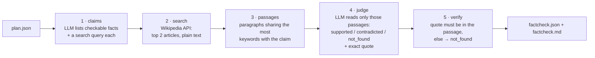

# Fact-check + sources

A small local model writes confident nonsense now and then. `pipeline/factcheck.py`
checks the narration against Wikipedia **before** you spend time voicing and rendering.

```bash
# on its own, for a plan you've written or edited
python pipeline/factcheck.py episodes/tree/plan.json

# as part of the pipeline: runs right after planning, stops if anything is contradicted
python pipeline/make_video.py --topic "Why do cats purr?" --id purr --plan-only --factcheck
python pipeline/make_video.py --plan episodes/purr/plan.json --id purr --factcheck
```

It writes two files next to the plan:

| File | For |
| --- | --- |
| `factcheck.md` | you: contradicted claims first (with the Wikipedia sentence that disagrees), then claims it couldn't confirm, then the supported ones with their quotes |
| `factcheck.json` | the pipeline: sources of **supported** claims go into the YouTube description and onto the outro card ("CHECKED AGAINST WIKIPEDIA · Photosynthesis · Wood") |

## How it works



Design choices, and why:

- **The LLM never browses.** Python fetches the text; the model only reads what it's given.
  That keeps it local, predictable and cheap: a handful of API calls per episode.
- **Keyword overlap, not embeddings**, to pick passages. It needs no extra model, and
  Wikipedia paragraphs are short and on-topic, so it works well enough. If you want better
  recall later, swap `best_passages()` for an embedding search (e.g. `nomic-embed-text` in Ollama).
- **Quotes are checked in code.** A "supported" verdict whose quote isn't literally in the
  source is downgraded to "not found". The model can't invent evidence.
- **Ollama structured output** (`format` = JSON schema from the Pydantic models), same as the
  planner, so replies always parse.
- Wikipedia asks API clients to send a descriptive `User-Agent` (`USER_AGENT` at the top of
  the file). Put your own contact in it if you publish regularly.

## Reading the verdicts

| Verdict | Meaning | What to do |
| --- | --- | --- |
| ✓ supported | a Wikipedia sentence says it | nothing; it's listed as a source |
| ✗ contradicted | a Wikipedia sentence disagrees | fix the narration in `plan.json` |
| ? not_found | nothing found settles it | check by hand, soften it ("about", "can"), or cut it |

Not found is common for things that are true but phrased differently, and for numbers.
It's a prompt to look, not proof of an error.

## Testing without Ollama or the internet

`check()` and `run()` accept your own `llm` and `fetch` functions, so you can test with
canned replies:

```python
import factcheck as fc
fc.run(Path("episodes/tree/plan.json"), "mock", llm=my_fake_llm, fetch=my_fake_wikipedia)
```

## Limits

- Wikipedia only. For medicine, law or fast-moving news, check primary sources yourself.
- An 8B model can miss claims or merge two into one. Read `factcheck.md`, don't just
  trust the count.
- It checks the narration, not the graph. A wrong arrow ("rain → sun") won't be caught.
