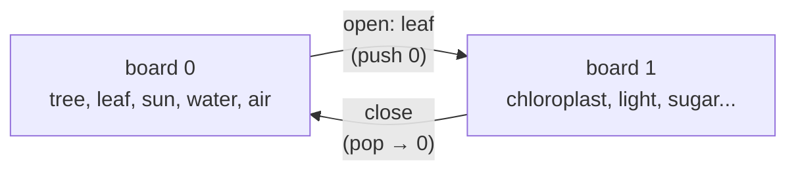

# Zooming into a node

Some nodes are whole systems of their own. A leaf is a sugar factory, a cell is a city,
a bank is a machine for moving money. A zoom lets Vertie dive inside a node, build its
insides on a fresh board, take *that* apart, and come back out.

Example: `episodes/tree/plan.json` ("Where does a tree come from?") dives into **Leaf**,
builds chloroplast → sugar + oxygen, pulls out the light, puts it back, and surfaces.

```bash
python pipeline/make_video.py --plan episodes/tree/plan.json --id tree
```

## In the plan

| Field | Meaning |
| --- | --- |
| `"open": "leaf"` | this scene dives into node `leaf`; its `add_nodes` start the inside |
| `"close": true` | this scene surfaces back to the board you dived from, exactly as you left it |

Zooms can nest (a cell inside a leaf inside a tree). Each `close` goes up one level.

`clean_plan()` keeps it safe:
- It ignores `open` on an unknown node, on the first scene, or while a node is pulled out.
- It ignores `close` with nothing to close, or while a node is pulled out.
- A node id that was already used on another board is renamed (`sun` inside the leaf
  becomes `sun_2`). Edges, focus, reach and remove on that board follow the rename, so
  the LLM can reuse natural ids.

## How boards work

Every scene belongs to a **board** (the `group` number on scenes, nodes and edges).
`plan_schema.boards()` walks the scenes with a stack:



- `new_graph` starts a new board and forgets the stack.
- `open` pushes the current board and starts a new one.
- `close` pops back. Its nodes keep their layout, because `layout.py` lays out each board
  once, using every node it will ever have.

`layout.py` and `make_video.py` both use `boards()`, so they always agree.

## In episode.json

| Field | Meaning |
| --- | --- |
| `scenes[].zoom` | `{dir: "in" \| "out", node}` on the scene that dives or surfaces; `node` is on the outer board |
| `scenes[].path` | breadcrumb labels, outermost first (`["Leaf"]`), drawn as "INSIDE LEAF" |
| `scenes[].animOffset` | 1.7 s on zoom scenes: node pops, edges, pulls and nudges wait for the dive |

## The transition

All times are seconds from the start of the zoom scene (constants in `director.ts`).

**Diving in** (`dir: "in"`)

| Time | What happens |
| --- | --- |
| 0 → 0.55 | still on the outer board; Vertie hops into the node and shrinks away |
| 0.35 → 1.0 | camera dives at the node; zoom grows geometrically until the disc covers the screen, and the node's colour fades to solid |
| 1.0 → 1.7 | switch to the inner board; a porthole (ring in the node's colour) opens from the centre (`IRIS`) |
| 1.25 → 1.8 | Vertie drops in from above |
| 1.0 → 2.3 | camera settles from 1.6× to the inner board's framing |
| 1.7 + | the scene's own animation (`animOffset`) |

**Surfacing** (`dir: "out"`) is the reverse: the porthole closes on the inner board
(0 → 0.7), then the camera pulls back out of the node on the outer board (0.7 → 1.9),
and Vertie hops out of the node to its spot.

During the dive the camera keeps the node's *screen offset* changing linearly while the
zoom changes geometrically, so the node slides smoothly to the centre instead of drifting.

The porthole is drawn in screen space by `Portal` in `Episode.tsx`. The director only
says how solid the colour is (`cover`) and how open the hole is (`iris`).

> **Sync contract:** `ZOOM_LEAD` in `make_video.py` must equal `ZOOM_LEAD` in
> `director.ts`. `simulate.py` reads each scene's `animOffset`, so nudges inside a
> zoom scene stay in sync automatically.

## Ideas

- Give the inside its own background tint (the node's colour, very faint) so you always
  know you're inside something.
- Show the outer node as a ring around the inner board for the first few seconds.
- Let the thumbnail pick the zoomed node as its hero.
